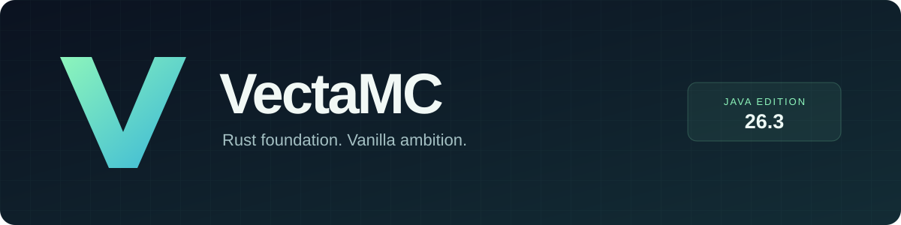

<p align="center">
  
</p>

<p align="center">
  <a href="https://github.com/Daniiltoptl/VectaMC/actions/workflows/ci.yml"></a>
  
  
  <a href="LICENSE"></a>
</p>

<p align="center">
  <b>Сервер Minecraft на Rust. Шаг за шагом — к ванильному поведению.</b><br>
  Основан на SteelMC · Базовая версия 26.3 · Сначала полноценное выживание
</p>

<p align="center">
  <a href="#состояние-проекта">Состояние</a> ·
  <a href="#сборка">Сборка</a> ·
  <a href="ROADMAP.md">План разработки</a> ·
  <a href="CHANGELOG.md">Изменения</a> ·
  <a href="PROVENANCE.md">Происхождение</a>
</p>

---

## Что такое VectaMC

**VectaMC** — развитие [SteelMC](https://github.com/Steel-Foundation/SteelMC)
с целью воспроизвести поведение официального сервера Minecraft Java Edition.
Первый ориентир — **26.3**: предметы должны работать, мобы — вести себя правильно,
а игровой прогресс — сохраняться между запусками.

Мы дополняем недостающие механики и проверяем их по эталону выбранной версии.
Плагины и дополнительные возможности Paper, Purpur и Folia запланированы
после ванильной основы.

> [!IMPORTANT]
> **Проект в pre-alpha. Полное ванильное выживание ещё не реализовано.**
> Наличие предмета в реестре не означает, что все его действия работают.
> Используйте отдельный тестовый мир; готовность к публичному серверу не заявляется.

## Состояние проекта

| Область | Текущее состояние |
| --- | --- |
| Сеть и вход игрока | Базовая реализация унаследована от SteelMC |
| Чанки, генерация, освещение и сохранение | Унаследованы; требуют дальнейших проверок VectaMC |
| Предметы и блоки | Реестры есть; специализированные поведения реализованы частично |
| Инвентарь, крафты и меню | Реализованы частично |
| Мобы, AI и естественный спавн | Неполная реализация |
| Бой, редстоун и остальные системы выживания | Требуют аудита и доработки |
| Совместимость с официальным сервером | Полное соответствие пока не подтверждено |
| Клиенты 1.21–26.2, будущие 26.4+ | Запланированы; сейчас не поддерживаются |
| Плагины | Отложены |

Конкретные изменения VectaMC перечислены в [CHANGELOG](CHANGELOG.md).
Исходная точка и авторство описаны в [PROVENANCE](PROVENANCE.md).
Мы не приписываем проекту результаты измерений и проверок upstream как собственные.

### Уже добавлено в VectaMC

**Пузырёк опыта — бросок из рук.** Работают обе руки, расход в выживании,
креатив, полёт, разбивание, выпадение опыта и сохранение данных пузырька.
Сферы получают направление разлёта по правилам 26.3. Добавлены регрессионные
тесты. Раздатчики и проверка настоящим клиентом остаются отдельными задачами.

## Сборка

Нужны **Git**, toolchain Rust из `rust-toolchain.toml` и компилятор C/C++.
На Windows установите Visual Studio Build Tools с компонентами C++ и Windows SDK;
на Linux нужен также `lld`, указанный в `.cargo/config.toml`.
Первая сборка загружает Rust-зависимости и ресурсы целевой версии Minecraft.

```sh
git clone https://github.com/Daniiltoptl/VectaMC.git
cd VectaMC
cargo build --release --locked -p vecta --features stand-alone
```

Исполняемый файл — **`vecta`**: `target/release/vecta`
или `target/release/vecta.exe` на Windows. Внутренние crates используют префикс
`vecta-*`; в консоли и клиенте сервер называется **VectaMC**.

### Тестовый запуск

Прежде чем запускать сервер, ознакомьтесь с [Minecraft EULA](https://www.minecraft.net/eula)
и подтвердите своё согласие самостоятельно.

```sh
cargo run --release --locked -p vecta --features stand-alone
```

Настройки создаются в `config/config.toml`, `config/worlds.toml` и
`config/groups.toml`. Запуск настоящего клиента и игровой сценарий проверяются
отдельно от успешной компиляции.

## Как проверяем ванильное поведение

Для разработки используем локальный эталон из официального сервера **26.3**.
Нужны Python 3.11+ и Java 25; `JAVA_HOME` должен указывать на подходящий JDK.

```sh
python scripts/prepare_vanilla.py
```

В Git Bash/Linux доступен тот же шаг через `./update-minecraft-src.sh`.
Скрипт читает версию из `Cargo.toml`, проверяет контрольные суммы загрузок
и создаёт `minecraft-src/minecraft/src/`. Gradle не требуется.
Исходники Minecraft и скачанные JAR остаются локальными и не попадают в Git.
Подробности — в [PROVENANCE](PROVENANCE.md).

```sh
cargo check --locked --workspace
cargo test --locked --workspace
cargo fmt --all --check
cargo clippy --locked --all-targets --all-features -- -D warnings
python -m unittest discover -s scripts -p "test_*.py" -v
```

## Этапы разработки

1. **Основа:** воспроизводимая сборка, эталон 26.3 и проверяемый список пробелов.
2. **Предметы и выживание:** взаимодействия, инвентарь, ресурсы и боевые механики.
3. **Живой мир:** мобы, AI, жидкости, редстоун, измерения и боссы.
4. **Проверка:** сравнение с ваниллой, сохранение и длительные игровые прогоны.
5. **Расширение:** другие версии Minecraft, затем плагины.

Подробный список и критерии готовности — в [ROADMAP](ROADMAP.md).

## Благодарности и лицензия

Основу проекта создали **Alve Jeansson и участники SteelMC**.
История Git, уведомления об авторстве и лицензия сохранены;
[исходный README SteelMC](UPSTREAM.md) доступен отдельно.

VectaMC распространяется по **GNU AGPL v3.0 or later** — см. [LICENSE](LICENSE).
Minecraft принадлежит Mojang/Microsoft. VectaMC — независимый проект,
не связанный с Mojang/Microsoft и не одобренный ими.
